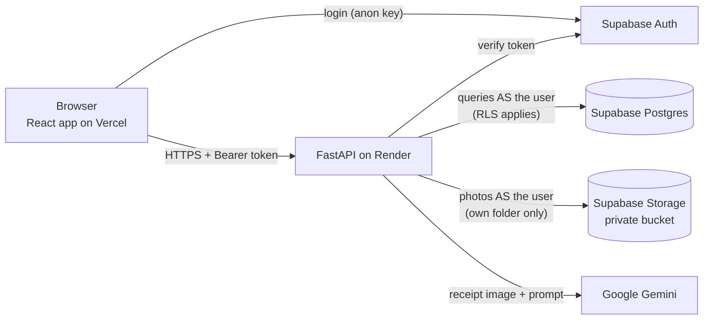

# BonScan – AI expense tracker for German supermarket receipts

Photograph a receipt from REWE, Lidl, ALDI or dm. An AI vision model reads the store, date, items,
prices and VAT, sorts every item into a category, and a dashboard shows where your money goes,
with budgets, forecasts, price tracking and spending alerts.

**🔗 Live demo:** _coming soon – `https://<your-app>.vercel.app`_
(demo login: _add the demo account's email/password here, or offer a "Try the demo" button_)

> The backend runs on Render's free tier, which sleeps when unused. The first request after a
> break can take up to a minute; the app shows "Waking up the server…" meanwhile.

## Screenshots

| Dashboard | Scan & review | Budgets & insights |
| --- | --- | --- |
| _`docs/screenshots/dashboard.png`_ | _`docs/screenshots/review.png`_ | _`docs/screenshots/insights.png`_ |

## Features

- **Receipt scanning:** photo or camera upload → Gemini reads the receipt into structured JSON
  (German formats: `2,49`, SUMME, MwSt A/B, Pfand, Rabatt) → you review and correct it next to the photo.
- **Automatic categories:** groceries, drugstore, household, drinks & snacks, deposit (Pfand), and more.
- **Dashboard:** monthly totals vs last month, spending by category (donut) and store (bars),
  12-month trend, top items, and a price tracker per item and store.
- **Budgets:** monthly limits per category with green / orange / red progress bars.
- **Forecasts:** "At this pace you'll spend about 312 € this month" plus a next-month forecast,
  shown as a dashed line on the trend chart.
- **Insights:** plain-language alerts for unusual category spending, budgets at risk and price increases.
- **CSV export** for German Excel (`;` separator, comma decimals).
- **Mobile friendly**, with camera capture on phones.

## Tech stack

| Part | Tech |
| --- | --- |
| Frontend | React 19, Vite, Tailwind CSS 4, React Router, Recharts (in `frontend/`) |
| Backend | Python 3.11, FastAPI, Pydantic (in `backend/`) |
| Database, auth, file storage | Supabase: Postgres with Row Level Security, Supabase Auth, private Storage bucket |
| Receipt AI | Google Gemini Flash via the official `google-genai` SDK, with structured JSON output |
| Tests | pytest (forecasts, alerts, CSV export, security helpers) |
| Hosting | Vercel (frontend), Render (backend), Supabase (data) |

## Architecture



1. The React app signs users in with **Supabase Auth** and sends their access token to the API.
2. **FastAPI** checks the token with Supabase, then talks to the database and storage **with the
   same user token**, so Supabase's Row Level Security decides what each user may see or change.
3. For a scan, FastAPI validates the image, counts it against the daily limit, stores it in the
   user's private folder and asks **Gemini** to extract the receipt as JSON.
4. Dashboard numbers, forecasts and alerts are calculated in plain Python in the backend
   (`app/analytics.py`, `app/services/`).

```
bonscan/
├── backend/            FastAPI app
│   ├── app/            main.py, auth, receipts, routers/ (analytics, budgets, insights, export), services/
│   ├── scripts/        test_extract.py (try the AI on photos), seed_demo.py (demo data)
│   └── tests/          pytest unit tests
├── frontend/           React app (pages/, components/, lib/), vercel.json
└── supabase/schema.sql tables, RLS policies, storage bucket, scan-limit function
```

## Run locally on Windows

You need **Python 3.11**, **Node.js 20+**, a free **Supabase** project and a free **Gemini API key**.

### 1. Supabase (one time)

1. Create a project at https://supabase.com/dashboard.
2. **SQL Editor → New query** → paste all of [`supabase/schema.sql`](supabase/schema.sql) → **Run**
   (safe to run again after updates).
3. **Project Settings → API Keys:** note the **Project URL** and the **anon / publishable** key.
   You do **not** need the service_role / secret key.
4. **Authentication → URL Configuration:** set **Site URL** to `http://localhost:5173`.
5. Optional for local testing: **Authentication → Sign In / Providers → Email** → turn off **Confirm email**.

### 2. Backend (Windows CMD)

```bat
cd /d D:\Project\bonscan\backend
python -m venv .venv
.venv\Scripts\activate.bat
pip install -r requirements-dev.txt
copy .env.example .env
notepad .env
uvicorn app.main:app --reload
```

Fill in `.env` (see [`backend/.env.example`](backend/.env.example)). API docs: http://localhost:8000/docs

### 3. Frontend (second CMD window)

```bat
cd /d D:\Project\bonscan\frontend
npm install
copy .env.example .env
notepad .env
npm run dev
```

Open http://localhost:5173. Missing settings are shown on a setup screen instead of a blank page.

### 4. Tests and helper scripts

```bat
cd /d D:\Project\bonscan\backend
.venv\Scripts\activate.bat
python -m pytest -v
python scripts\test_extract.py
python scripts\seed_demo.py --user-id <uuid> --dry-run
```

- `test_extract.py` reads every photo in `backend/test_receipts/` (git-ignored, real receipts are private)
  and prints the AI result, pausing between calls to respect the Gemini free tier.
- `seed_demo.py` fills **one demo account** with ~3 months of fake receipts (see [Demo account](#demo-account)).

## Deploy (Render + Vercel + Supabase)

Deploy the backend first, then the frontend, then connect the two.

### Backend on Render (free web service)

| Setting | Value |
| --- | --- |
| Runtime | Python 3 |
| Root Directory | `backend` |
| Build Command | `pip install -r requirements.txt` |
| Start Command | `uvicorn app.main:app --host 0.0.0.0 --port $PORT` |
| Health Check Path | `/api/health` |
| Python version | from `.python-version` (`3.11`) |

Environment variables: `FRONTEND_ORIGINS`, `SUPABASE_URL`, `SUPABASE_ANON_KEY`, `GEMINI_API_KEY`,
`GEMINI_MODEL`, `GEMINI_TIMEOUT_SECONDS`, `SCAN_LIMIT_PER_DAY`.
Set `FRONTEND_ORIGINS` to your Vercel URL (e.g. `https://bonscan.vercel.app`, no trailing slash).

### Frontend on Vercel (free)

| Setting | Value |
| --- | --- |
| Framework Preset | Vite |
| Root Directory | `frontend` |
| Build Command | `npm run build` |
| Output Directory | `dist` |

Environment variables: `VITE_API_URL` (your Render URL, e.g. `https://bonscan-api.onrender.com`),
`VITE_SUPABASE_URL`, `VITE_SUPABASE_ANON_KEY`. Vite bakes these into the build, so **redeploy after
changing them**. `frontend/vercel.json` sends every path to `index.html`, so pages like `/dashboard`
work on refresh.

### Supabase settings for production

- **Authentication → URL Configuration:** set **Site URL** to your Vercel URL and add
  `https://<your-app>.vercel.app/**` (and `http://localhost:5173/**` for local work) to **Redirect URLs**.
- Run the latest `supabase/schema.sql` once more if you changed anything.

### Demo account

1. Sign up in the deployed app with a dedicated demo email, and copy its user id from
   **Supabase → Authentication → Users**.
2. In your **local** `backend/.env`, set `DEMO_EMAIL` and `DEMO_PASSWORD` (never on Render).
3. Run `python scripts\seed_demo.py --user-id <uuid> --dry-run` to preview, then without `--dry-run`
   to insert. Use `--replace` to refresh the data later (it only deletes receipts it created itself).

The script logs in **as the demo user** (no service key), so Row Level Security makes it impossible to
write anyone else's data, and it refuses to run if the login doesn't match `--user-id`.

## Security & privacy

- **Row Level Security everywhere.** Every table has RLS; users can only read and change their own
  receipts, items and budgets. Categories are read-only.
- **No service key.** Frontend and backend use only the public anon key. The backend makes every
  database and storage call **with the logged-in user's token**, so the same RLS rules apply as in the browser.
- **Private, per-user photo folders.** Receipt photos live in a private bucket at `<user_id>/<uuid>.jpg`;
  storage policies only allow users to upload, read and delete inside their own folder. Photos are shown
  through signed links that expire after 10 minutes.
- **Daily scan limit.** Each user can run `SCAN_LIMIT_PER_DAY` (default 15) AI scans per day. The count is
  kept by a database function users can't bypass; at the limit the API answers
  "Daily scan limit reached, try again tomorrow" (HTTP 429).
- **Secrets stay out of code, logs and git.** Keys live only in `.env` files (git-ignored) or the
  hosting dashboards. A log filter masks anything that looks like a token or API key, request URLs aren't
  logged, and the user's token is hidden from error messages.
- **Untrusted input is checked.** Uploaded files are verified with Pillow (type and 10 MB limit), all API
  input is validated with Pydantic, and the CSV export neutralises cells that Excel could run as formulas.
- **Strict CORS.** Only the origins listed in `FRONTEND_ORIGINS` may call the API from a browser.
- **AI data:** receipt photos are sent to Google's Gemini API for extraction. Check Google's current
  Gemini API terms before uploading other people's receipts. Demo data is entirely made up.

## How it works

### Receipt scanning

1. **Check & limit** (`app/images.py`, `app/receipts.py`): JPG, PNG or WEBP up to 10 MB (iPhones convert
   HEIC to JPEG automatically); the scan is counted against the daily limit.
2. **Store** the photo privately at `receipts/<user_id>/<uuid>.<ext>`.
3. **Extract** (`app/extraction.py`): Gemini gets the photo and a prompt with German receipt rules and must
   answer with JSON matching a Pydantic schema; categories are restricted to those in the database.
4. **Check:** if the items don't add up to the total (± 0,05 €), the user sees a warning, not an error.
5. **Review & save** in the frontend.

### Dashboard numbers

- Totals, stores and the trend use **receipt totals** (what you paid); categories and items use **item prices**.
- Discounts and returned deposit are negative and reduce their category.
- Similar item names are grouped (`"H-Milch 3,5% 1L"` = `"H-MILCH 3,5%"`), and store names ignore case.

### Forecasts and alerts (`app/services/`)

- **End of month:** `spent so far ÷ days passed × days in month`.
- **Next month:** `0,5 × last month + 0,3 × the month before + 0,2 × the one before` (complete months only;
  fewer than 2 months of data → "not enough data yet").
- **Category alert:** more than 30 % **and** at least 10 € above the average of the previous 3 months.
- **Budget alert:** ≥ 80 % used, over budget, or projected to go over.
- **Price alert:** same item at the same store more than 15 % pricier than last time (deposit lines excluded).

## API

All endpoints except `/api/health` need `Authorization: Bearer <Supabase access token>`.
Interactive docs: `/docs` on the running backend.

| Method | Path | Returns |
| --- | --- | --- |
| GET | `/api/health` | status + whether Supabase and Gemini are configured |
| GET | `/api/me` | the logged-in user's id and email |
| GET | `/api/categories` | all categories |
| POST | `/api/receipts/extract` | upload a photo → AI draft + warnings (not saved; counts towards the daily limit) |
| POST / GET | `/api/receipts` | save a reviewed receipt / list your receipts |
| GET / DELETE | `/api/receipts/{id}` | one receipt with items and photo link / delete it |
| GET | `/api/analytics/summary`, `/by-category`, `/by-store`, `/top-items` `?month=YYYY-MM` | dashboard numbers |
| GET | `/api/analytics/monthly-trend?months=12` | totals per month |
| GET | `/api/analytics/price-history?item=milch` | an item's price over time per store |
| GET / PUT / DELETE | `/api/budgets`, `/api/budgets/{category_id}` | list / set / remove monthly limits |
| GET | `/api/budgets/progress?month=YYYY-MM` | spent vs limit per budget |
| GET | `/api/insights/forecast` | end-of-month projection + next-month forecast |
| GET | `/api/insights/alerts` | plain-language alerts with the numbers behind them |
| GET | `/api/export/csv?from=YYYY-MM-DD&to=YYYY-MM-DD` | CSV for German Excel |

## Known limitations

- The free Render instance sleeps after ~15 minutes without traffic (first request then takes up to a minute).
- Forecasts are deliberately simple and explainable, not machine learning.
- HEIC files are rejected on the server; phones upload JPEG instead.
- Calculations use plain Python instead of pandas, because pandas' native libraries were blocked by Windows
  Smart App Control on the development machine.
